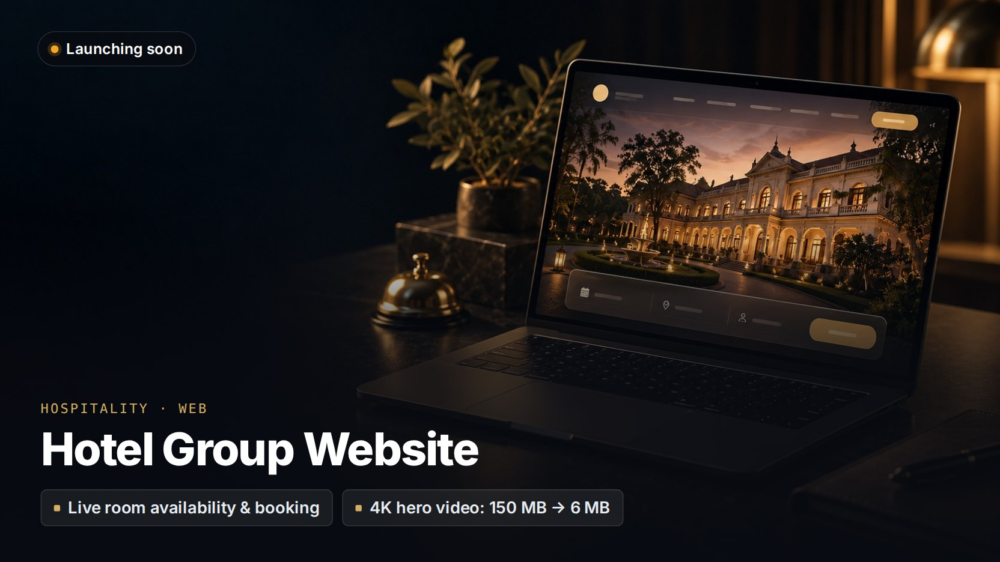

# Hotel Group Website

> **A cinematic brand site with live availability and online booking.**
>
> This is a showcase repo. The source code is private and the client's name is withheld. A live demo or a code walkthrough is available on request.

**Client:** A multi-property hotel group  
**My role:** Architecture, design and full-stack development through Kryyvo  
**Status:** Final phase, launching soon  
**Live site:** link coming at launch

## The problem

The group needed a website that feels as premium as its hotels, and one that lets guests check real availability and book, rather than send an enquiry and wait.

## What I built

- **Landing experience.** Nine scroll-driven sections, each with its own layout for phone, tablet and desktop.
- **Property template** reused across the group's hotels.
- **Booking flow** with live room types, rates, availability and taxes from the hotels' management system, and card payments (currently wired to the payment provider's test environment).
- **Event enquiries** that save to a spreadsheet and notify the team by email and SMS.
- **SEO, structured data and accessibility** built in from the start.

## Engineering highlights

- Swapping a photo or video can never break the layout: sizes and focal points are measured at build time, not hard-coded.
- The build fails if an asset or a design token is missing.
- Each view is checked against the approved design by script, not by eye.
- The 150 MB 4K hero master was transcoded to a 6 MB 1080p stream, with a 2.7 MB version for phones.

## Stack

| Layer | Technology |
|---|---|
| **Frontend** | Next.js 16, React 19, TypeScript, CSS Modules |
| **Motion** | GSAP, ScrollTrigger, Lenis |
| **Media** | sharp, ffmpeg, Cloudflare R2 |
| **Hosting** | Vercel |

---

[← More projects on my profile](https://github.com/husnainms) · Want a demo or a code walkthrough? Email [info@kryyvo.com](mailto:info@kryyvo.com).
